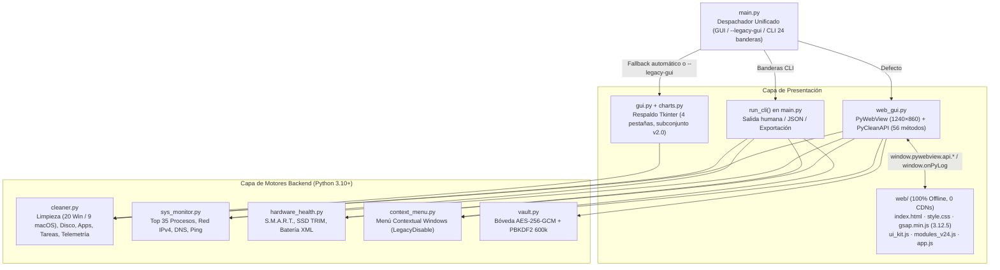

# 🏗️ Arquitectura Técnica y Puente API — PyClean Pro v2.6.0

Este documento describe la arquitectura interna de **PyClean Pro v2.6.0**, sus 5 motores backend en Python, su interfaz web 100% offline, la referencia completa de los **56 métodos públicos** de `PyCleanAPI` (`window.pywebview.api`), las ubicaciones de archivos por sistema operativo y la suite de pruebas unitarias.

> **Volver al inicio:** [`README.md`](../README.md) · **Seguridad y Bóveda:** [`SEGURIDAD_Y_BOVEDA.md`](SEGURIDAD_Y_BOVEDA.md) · **Compilación:** [`COMPILACION_Y_RELEASE.md`](COMPILACION_Y_RELEASE.md)

---

## 1. Diagrama de Capas



---

## 2. Los 5 Motores Backend

| Módulo | Responsabilidad Principal | Dependencias Clave / APIs del SO |
|---|---|---|
| [`cleaner.py`](../cleaner.py) | 20 categorías de limpieza en Windows / 9 nativas en macOS, filtro de retención 24 h, guardia de symlinks/*junctions*, triturador seguro, duplicados SHA-256, Treemap, particiones, archivos gigantes, auditor de descargas, inicio de Windows (`Run`↔`RunDisabled`), desinstalador + residuos, Programador de Tareas (`schtasks`), telemetría (`sc`/`winreg`), compactación RAM (`EmptyWorkingSet`), vaciado DNS (`ipconfig`) y reportes `.json`/`.txt`. | `ctypes` (Win32 `shell32`, `psapi`, `kernel32`), `winreg`, `psutil`, `hashlib`, `subprocess`. |
| [`sys_monitor.py`](../sys_monitor.py) | Top 35 procesos por RAM/CPU con protección de 18 procesos críticos y PIDs `0`/`1`/`4`/propio, listado de interfaces IPv4 activas, presets DNS en Windows (`netsh` + `flush_dns`) y prueba de latencia `ping` con validación regex. *(Sin métricas de GPU).* | `psutil`, `subprocess`, `re`. |
| [`hardware_health.py`](../hardware_health.py) | Salud de discos físicos S.M.A.R.T. (`Get-PhysicalDisk`), optimización SSD TRIM (`Optimize-Volume -ReTrim`, validación `^[A-Z]$`) y salud/desgaste/ciclos de batería (`psutil` + parser XML de `powercfg /batteryreport /xml`). *(Sin sensores térmicos ni de ventiladores).* | `psutil`, `xml.etree.ElementTree`, `subprocess`, `re`. |
| [`context_menu.py`](../context_menu.py) | Auditoría y ocultación/reactivación reversible de entradas de terceros en el menú contextual ("clic derecho") del Explorador de Windows en 6 ámbitos (`HKCU`/`HKCR`) mediante `LegacyDisable`, protegiendo 15 verbos nativos. *(No añade PyClean al menú contextual).* | `winreg`. |
| [`vault.py`](../vault.py) | Bóveda local de contraseñas *Zero-Knowledge* offline: `PBKDF2-HMAC-SHA256` (600,000 iteraciones, salt 16 B, clave 32 B), `AES-256-GCM` (nonce 12 B único por guardado, tag 16 B, AAD `pyclean-pro-vault-v1`), escritura atómica (`os.replace()`), auto-bloqueo (300 s), generador CSPRNG (`secrets`) y evaluador de entropía. | `cryptography`, `secrets`, `json`, `os`. |

---

## 3. Arquitectura Frontend (100% Offline) y Respaldo Tkinter

### Interfaz Moderna (`web_gui.py` + `web/`)
- **Cero dependencias externas (0 CDNs):** Todos los recursos son locales (`web/`), los íconos son SVG en línea y las tipografías utilizan la pila nativa del sistema.
- **Orden de carga de scripts en [`web/index.html`](../web/index.html):**
  1. [`web/gsap.min.js`](../web/gsap.min.js) — **GSAP 3.12.5** empaquetado localmente para animaciones de entrada, transiciones entre pestañas, medidores SVG circulares, contador de espacio recuperable, barras de desglose y pulso visual al completar limpieza.
  2. [`web/ui_kit.js`](../web/ui_kit.js) — Gestor de 3 temas CSS (`dark-theme`, `oled-theme`, `light-theme` persistidos en `localStorage["pyclean_theme"]`), notificaciones Toast flotantes (`window.showToast`) y modal de confirmación basado en Promesas (`window.showConfirmModal`).
  3. [`web/modules_v24.js`](../web/modules_v24.js) — Controladores UI para las vistas de Monitor y Red, Salud Hardware, Menú Contextual y Bóveda de Contraseñas (`initV24Modules`, `onV24TabSelected`).
  4. [`web/app.js`](../web/app.js) — Estado global (`AppState`), enlace con `window.pywebview`, controladores de Dashboard, Limpieza, Archivos Top, Inicio Rápido, Mapa de Disco, Desinstalador, Privacidad, Ajustes y Herramientas.
- **Modo Mock en navegador (`initMockApp`):** Si `web/index.html` se abre directamente en un navegador web sin PyWebView, tras 800 ms `app.js` activa datos simulados para facilitar el desarrollo y ajuste visual de la interfaz.
- **Comunicación bidireccional:**
  - **JS → Python:** Invocación asíncrona de métodos de `PyCleanAPI` mediante `window.pywebview.api.<metodo>(...)` (PyWebView los ejecuta en hilos de trabajo en segundo plano y retorna Promesas).
  - **Python → JS:** `PyCleanAPI.log()` inserta mensajes en la consola en vivo invocando `window.onPyLog(msg, tag)` vía `evaluate_js()`.
- **Diálogos nativos de archivo/carpeta:** `pick_folder()` y `pick_file()` utilizan `tkinter.filedialog` (ventana oculta `-topmost`), mientras que `vault_export_backup()` y `vault_import_backup()` emplean `window.create_file_dialog()` nativo de PyWebView.

### Interfaz Clásica de Respaldo (`gui.py` + `charts.py`)
- Se activa automáticamente si falla la inicialización de PyWebView o explícitamente con `python main.py --legacy-gui`.
- Implementa `PyCleanGUI` en Tkinter/TTK (tema oscuro `clam`, ventana `1080×840`) con gráficos personalizados en `tk.Canvas` (`DonutChart` y `HorizontalBarBreakdown` en [`charts.py`](../charts.py)).
- Solo importa `cleaner.py` y expone el subconjunto de funciones v2.0 en **4 pestañas** (Dashboard, Opciones de Limpieza, Inicio de Windows y Ajustes).

---

## 4. Referencia Completa de `PyCleanAPI` (56 Métodos Públicos)

`PyCleanAPI` en [`web_gui.py`](../web_gui.py) expone **56 métodos públicos**: **53 invocados activamente** desde `web/app.js` y `web/modules_v24.js`, más **3 métodos públicos internos o no invocados desde JS** (`set_window`, `log`, `get_locked_apps`).

### 4.1 Métodos Internos / No Invocados desde JS (3)

| # | Método | Parámetros | Estado / Uso |
|---|---|---|---|
| 1 | `set_window` | `(window)` | *Interno (no invocado en JS)* — Llamado por `run_web_gui()` para enlazar la ventana PyWebView. |
| 2 | `log` | `(message, tag="dim")` | *Interno (no invocado en JS)* — Empuja logs de Python hacia JS mediante `window.onPyLog`. |
| 3 | `get_locked_apps` | `()` | *No invocado en JS* — Retorna apps bloqueadas; en la UI estos datos llegan empaquetados dentro de `get_initial_state`. |

### 4.2 Estado Global, Limpieza, Sistema y Diálogos (16)

| # | Método | Parámetros | Retorno | Invocado desde |
|---|---|---|---|---|
| 4 | `get_initial_state` | `(drive="C:\\")` | `{drives, stats, is_admin, config, categories[], locked_apps[]}` | `app.js` |
| 5 | `get_system_stats` | `(drive="C:\\")` | `{stats, drives}` | `app.js` |
| 6 | `scan_category` | `(cat_key, min_age_hours=24, exclusions=None)` | `{key, size, count, size_formatted, items[:100]}` | `app.js` |
| 7 | `clean_category` | `(cat_key, min_age_hours=24, exclusions=None)` | `{key, freed, deleted, skipped, freed_formatted}` | `app.js` |
| 8 | `optimize_ram` | `()` | `{freed_processes, stats}` | `app.js` |
| 9 | `flush_dns` | `()` | `{success, message}` | `app.js` |
| 10 | `get_startup_programs` | `()` | `list[dict]` | `app.js` |
| 11 | `toggle_startup_program` | `(prog_data)` | `{success, message}` | `app.js` |
| 12 | `save_config` | `(cfg)` | `{success}` | `app.js` |
| 13 | `request_admin` | `()` | `{success: True}` (relanza con UAC en Windows) | `app.js` |
| 14 | `shred_file` | `(file_path, passes=1)` | `{success, message}` | `app.js` |
| 15 | `find_duplicates` | `(target_folder, min_size_kb=1)` | `{duplicates: list[dict]}` | `app.js` |
| 16 | `export_report` | `(report_data, format_type="json")` | `{success, message, filepath}` | `app.js` |
| 17 | `pick_folder` | `()` | `{folder: str}` | `app.js` |
| 18 | `pick_file` | `()` | `{file: str}` | `app.js` |
| 19 | `open_folder` | `(path)` | `{success, error?}` | `app.js` |

### 4.3 Desinstalador, Programador, Privacidad y Descargas (10)

| # | Método | Parámetros | Retorno | Invocado desde |
|---|---|---|---|---|
| 20 | `get_installed_apps` | `()` | `list[dict]` | `app.js` |
| 21 | `run_uninstaller` | `(uninstall_cmd)` | `{success, message}` | `app.js` |
| 22 | `find_app_leftovers` | `(app_name)` | `{leftovers: list[str]}` | `app.js` |
| 23 | `delete_leftovers` | `(paths)` | `{deleted: list[str], failed: list[str]}` | `app.js` |
| 24 | `get_scheduled_task_status` | `()` | `dict` (`{exists, enabled, ...}`) | `app.js` |
| 25 | `set_scheduled_task` | `(enabled, frequency="weekly")` | `{success, message}` | `app.js` |
| 26 | `get_telemetry_status` | `()` | `{services[], policy_disabled}` | `app.js` |
| 27 | `toggle_telemetry` | `(disable)` | `{success, message}` | `app.js` |
| 28 | `audit_old_downloads` | `(days=30)` | `{downloads: list[dict]}` | `app.js` |
| 29 | `delete_download_file` | `(file_path)` | `{success, message}` | `app.js` |

### 4.4 Mapa de Disco, Treemap y Archivos Gigantes (5)

| # | Método | Parámetros | Retorno | Invocado desde |
|---|---|---|---|---|
| 30 | `get_partitions_detailed` | `()` | `list[dict]` | `app.js` |
| 31 | `scan_folder_treemap` | `(target_path)` | `{items[], categories[], parent_path, error?}` | `app.js` |
| 32 | `find_largest_files` | `(target_path, min_size_mb=100, limit=50)` | `list[dict]` | `app.js` |
| 33 | `open_in_explorer` | `(target_path)` | `{success}` | `app.js` |
| 34 | `delete_or_shred_file` | `(file_path, shred=False)` | `{success, message}` (3 pasadas si `shred=True`) | `app.js` |

### 4.5 Monitor de Procesos/Red, Salud de Hardware y Menú Contextual (10)

| # | Método | Parámetros | Retorno | Invocado desde |
|---|---|---|---|---|
| 35 | `get_top_processes` | `(sort_by="memory", limit=35)` | `list[dict]` | `modules_v24.js` |
| 36 | `terminate_process` | `(pid)` | `{success, message}` | `modules_v24.js` |
| 37 | `get_network_interfaces` | `()` | `list[dict]` | `modules_v24.js` |
| 38 | `set_dns_preset` | `(adapter_name, preset)` | `{success, message}` | `modules_v24.js` |
| 39 | `run_ping_test` | `()` | `list[dict]` (`{label, host, reachable, latency_ms}`) | `modules_v24.js` |
| 40 | `get_disk_health` | `()` | `list[dict]` | `modules_v24.js` |
| 41 | `run_ssd_trim` | `(drive_letter="C")` | `{success, message}` | `modules_v24.js` |
| 42 | `get_battery_health` | `()` | `dict` (`{has_battery, percent, power_plugged, health_percent, wear_percent, ...}`) | `modules_v24.js` |
| 43 | `get_context_menu_items` | `()` | `list[dict]` | `modules_v24.js` |
| 44 | `toggle_context_menu_item` | `(hive, subkey, enable)` | `{success, message}` | `modules_v24.js` |

### 4.6 Bóveda Local de Contraseñas (12)

| # | Método | Parámetros | Retorno | Invocado desde |
|---|---|---|---|---|
| 45 | `vault_status` | `()` | `{crypto_available, exists, unlocked, ...}` | `modules_v24.js` |
| 46 | `vault_create` | `(master_password)` | `{success, message, status}` | `modules_v24.js` |
| 47 | `vault_unlock` | `(master_password)` | `{success, message, status}` | `modules_v24.js` |
| 48 | `vault_lock` | `()` | `{success: True, status}` | `modules_v24.js` |
| 49 | `vault_get_entries` | `()` | `{unlocked, entries[]}` | `modules_v24.js` |
| 50 | `vault_save_entry` | `(title, username, password, url="", category="General", notes="", entry_id=None)` | `{success, entry?, message}` | `modules_v24.js` |
| 51 | `vault_delete_entry` | `(entry_id)` | `{success, message}` | `modules_v24.js` |
| 52 | `vault_generate_password` | `(length=18, use_upper=True, use_lower=True, use_digits=True, use_symbols=True)` | `{password, strength}` | `modules_v24.js` |
| 53 | `vault_evaluate_strength` | `(password)` | `{score, label, color, entropy_bits}` | `modules_v24.js` |
| 54 | `vault_copy_secret` | `(secret_text, clear_after_seconds=30)` | `{success, clear_after}` | `modules_v24.js` |
| 55 | `vault_export_backup` | `()` | `{success, message}` (diálogo nativo Guardar) | `modules_v24.js` |
| 56 | `vault_import_backup` | `()` | `{success, message, status?}` (diálogo nativo Abrir) | `modules_v24.js` |

---

## 5. Ubicación de Archivos, Configuración y Datos por SO

| Artefacto | Windows | macOS | Linux |
|---|---|---|---|
| **Configuración del limpiador** | `<directorio_del_módulo>\cleaner_config.json` | `<directorio_del_módulo>/cleaner_config.json` | `<directorio_del_módulo>/cleaner_config.json` |
| **Bóveda cifrada** | `%APPDATA%\PyCleanPro\vault.enc` (respaldo `~\PyCleanPro\vault.enc`) | `~/.pycleanpro/vault.enc` | `~/.pycleanpro/vault.enc` |
| **Temporal atómico de Bóveda** | `<vault_path>.tmp` (transitorio durante guardado) | `<vault_path>.tmp` | `<vault_path>.tmp` |
| **Respaldo de Bóveda (GUI)** | Elegido por el usuario (`pyclean_vault_backup.vault`) | Elegido por el usuario (`pyclean_vault_backup.vault`) | Elegido por el usuario |
| **Reportes exportados (GUI)** | `~/Desktop/PyClean_Reporte_<timestamp>.{json,txt}` (respaldo `~/Descargas` o dir. del módulo) | Mismo comportamiento | Mismo comportamiento |
| **XML temporal de batería** | `%TEMP%\pyclean_batt_<pid>.xml` (eliminado automáticamente en `finally`) | N/A | N/A |
| **Logs internos (`pyclean`)** | Consola (`StreamHandler`, sin archivo en disco) | Consola (`StreamHandler`) | Consola (`StreamHandler`) |

---

## 6. Suite de Pruebas Unitarias (21 Tests)

El repositorio incluye **21 pruebas unitarias** automatizadas que se ejecutan en cada corrida de CI (Windows y macOS):

- **[`tests/test_cleaner.py`](../tests/test_cleaner.py) (13 pruebas):** Formateo de tamaños, exclusiones, filtro de retención por antigüedad, detección de enlaces simbólicos, escaneo/limpieza, triturador seguro, buscador de duplicados SHA-256, exportación de reportes, auditor de descargas, escáner de residuos, respaldos multiplataforma, particiones, Treemap y archivos gigantes.
- **[`tests/test_v24_modules.py`](../tests/test_v24_modules.py) (8 pruebas):** Protección de procesos críticos, validación anti-inyección de DNS/Ping, parser XML de reporte de batería, validación de letra de unidad en SSD TRIM, protección de verbos del menú contextual, ciclo de vida completo de la bóveda AES-256-GCM, evaluador de fortaleza de contraseñas y categorías/estadísticas nativas de macOS.

```bash
pip install -r requirements-dev.txt
pytest tests/ -v
```
